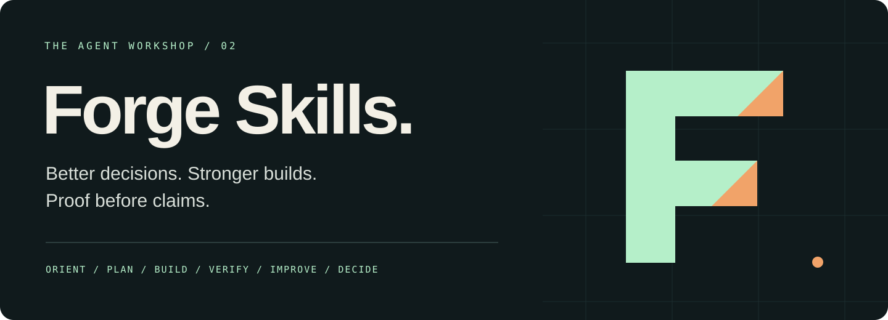
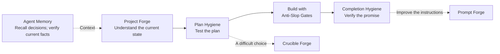

<p align="center">
  
</p>

<p align="center">
  <a href="docs/installation.md"><strong>Get started</strong></a> ·
  <a href="#choose-your-skill"><strong>Explore the skills</strong></a> ·
  <a href="docs/walkthrough.md"><strong>See the workflow</strong></a> ·
  <a href="docs/verification.md"><strong>What is tested</strong></a>
</p>

<p align="center">A practical toolkit for people who build with AI agents.<br>
Created and curated by <a href="https://github.com/qengine13">Avichayil</a>. Open source. Readable instructions. Inspectable tools.</p>

---

## Give your agent a better way to work

A convincing plan can rest on a missing dependency. A passing test can miss the real entry point.
A new session can lose the reason behind yesterday's decision.

Forge Skills gives agents repeatable ways to inspect the evidence, challenge assumptions,
keep code quality from slipping, and describe exactly what has been verified.
Install the skills you need. Invoke them when the work calls for them.

**Seven skills · Claude Code and Codex · Subscription-first agent work · Local memory included**

## Choose your skill

| When you need to… | Use | What you get |
|---|---|---|
| Remember decisions across sessions | [Agent Memory](docs/skills/agent-memory.md) | A runnable local server with recall, capture, corrections, and optional maintenance |
| Find the next useful action | [Project Forge](docs/skills/project-forge.md) | A grounded project assessment and next step |
| Check a plan before committing effort | [Plan Hygiene](docs/skills/plan-hygiene.md) | Dependencies, risks, scope, and proof-of-success gates |
| Stop quality debt from growing | [Anti-Slop Gates](docs/skills/anti-slop-gates.md) | Executable checks with downward-only debt limits |
| Verify a completion claim | [Completion Hygiene](docs/skills/completion-hygiene.md) | A promise-by-promise evidence audit |
| Improve a reusable prompt or skill | [Prompt Forge](docs/skills/prompt-forge.md) | Preserved constraints and a behaviour evaluation plan |
| Resolve a consequential decision | [Crucible Forge](docs/skills/crucible-forge.md) | Evidence, dissent, a decision, and reversal conditions |

## Start with one

Requires Git and Python 3.11 or newer for the installer and tools. Instruction-only skills can
also be copied manually. Run these in a terminal; change the project path to your own.

```bash
git clone https://github.com/qengine13/forge-skills.git
cd forge-skills
python3 scripts/install.py --agent claude --project /path/to/your-project --skill plan-hygiene
```

Open a new Claude Code session **inside your project**, then try:

```text
/plan-hygiene Check my proposal to add bulk invoice export. Inspect existing
export paths and dependencies, define what would prove success, and do not implement it.
```

For Codex, use `--agent codex` during installation and invoke `$plan-hygiene`.
Use `--all` instead of `--skill plan-hygiene` to install the collection.
Agent Memory also needs a one-time [server connection](docs/skills/agent-memory.md).
The installer refuses to overwrite an existing skill. [Installation, updating, and troubleshooting →](docs/installation.md)

## A workflow you can understand



You do not have to run every skill on every task. A small edit should stay a small edit.
[Walk through a concrete example →](docs/walkthrough.md)

## Your subscription. Your available models.

The skills prefer the newest stable, suitable model available through your current subscription
**when the host can verify and select it**. Your explicit model choice takes precedence.
When discovery or entitlement is unavailable, they keep the configured session model and say
that the latest eligible model is unverified. They never assume a chat subscription includes API credits.

Model choices stay fixed during a comparison so a newer model cannot masquerade as a better prompt.
[Read the full model policy →](docs/model-policy.md)

## Know what you are installing

- **Instructions:** Markdown workflows that the host agent interprets. They cannot guarantee compliance.
- **Tools:** A local installer, quality checks, offline decision validation, and a local memory server. Inspectable Python.
- **Memory:** Basic recall needs no model or API key. Optional model work is off by default; Claude adjudication uses a verified subscription CLI login.
- **Permissions:** The installer copies files only. It does not configure credentials, install hooks,
  change your model, or contact an AI provider. Invoked agents retain their own tools and permissions.
- **Evidence:** Automated package/tool checks are distinct from live model and end-to-end workflow tests.
  [Verification and limitations →](docs/verification.md)

## Make it yours

Use existing project rules and conventions. Choose individual skills. Keep the scope small.
Contributions should include a reproducible failure or a realistic scenario showing why a change helps.

[Privacy review](docs/privacy.md) · [Contributing](CONTRIBUTING.md) · [Provenance](docs/provenance.md) · [License](LICENSE) · [Report an issue](https://github.com/qengine13/forge-skills/issues)

**Related work:** [Gauntlet Loop](https://github.com/robonuggets/gauntlet-loop), an external project
credited to Matt Shumer (technique) and Jay E / RoboNuggets (packaging), is not bundled here.
