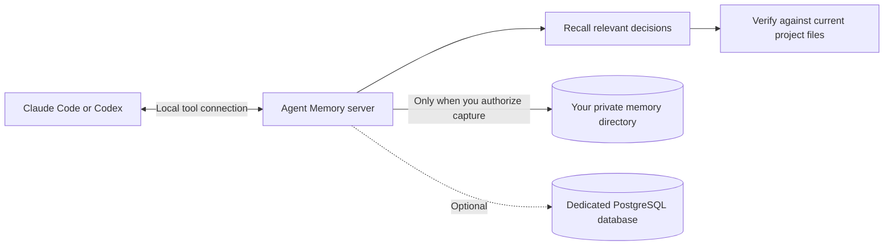

# Agent Memory

[← Collection](../../README.md) · [Installation](../installation.md) · [Verification](../verification.md)

**Keep the reason behind a decision, then check it against today's files.**
Agent Memory includes a runnable local server, not just instructions for an external service.
Start with private files and keyword search. Add PostgreSQL or local embeddings only when needed.



## What you get

| Capability | What it does | Requirements |
|---|---|---|
| Recall and recent history | Search by words and project; inspect prior decisions | Python 3.11+, private data directory |
| Capture and correction | Append structured notes; supersede an older same-project note | `--allow-writes` and your explicit capture instruction |
| Project truth | Read selected project documents as current evidence | Explicit project path and filesystem access |
| History inventory/import | Find local session candidates; draft one selected session into a note | Local Claude/Codex history; review before capture |
| Dream | Propose consolidation and apply reviewed changes | Advanced setup; configured PostgreSQL for the server tools |
| Heal | Propose stale/contradictory-note corrections; apply selected reviewed proposals | PostgreSQL; optional local embeddings and Claude CLI adjudication |
| Doctrine audit and trends | Review project activity against operating rules | Git, configured PostgreSQL; local session evidence when selected |
| Lessons and semantic recall | Export reusable lessons; build/search an embedding index | Optional operator scripts and Ollama |
| Gardener console | Inspect memory and review proposals in a local browser | PostgreSQL; local operator setup |

Recall happens when the host invokes the skill or tools; no automatic recall hook is installed.

The basic path needs **no account, API key, database service, or model download**. The connected
host still uses its normal subscription. The server does not automatically capture conversations,
install scheduled jobs, or connect to an existing memory service.

## 1. Install the whole skill

From the collection directory, choose your host:

```bash
python3 scripts/install.py --agent claude --project /path/to/project --skill agent-memory
# Or:
python3 scripts/install.py --agent codex --project /path/to/project --skill agent-memory
```

Use a real absolute project path. The entire `scripts/` directory must stay with the skill.
An `--all` installation already includes it. Installing the skill copies files; connecting its
server is the separate step below.

## 2. Connect a private store

Choose a directory outside Git, such as a `forge-memory` folder in your private application data.
Replace `/private/path/forge-memory` in these examples with that absolute path. Never commit the
memory directory. Separate stores for separate users or trust domains: project names are filters,
not security boundaries. This is a local, single-user tool with your filesystem permissions.

### Claude Code

Generate a configuration snippet from the **installed** launcher:

```bash
python3 /path/to/project/.claude/skills/agent-memory/scripts/run.py --data-dir /private/path/forge-memory --allow-writes --claude-config
```

Merge the printed `forge-memory` entry into the project's `.mcp.json` under `mcpServers`, preserving
other entries. The snippet uses the Python executable and installed script's absolute paths.
Keep machine-specific configuration private. Restart Claude Code and accept its normal server
trust prompt. `/mcp` should list `forge-memory`.

Omit `--allow-writes` for a read-only connection. The option grants capability; it does not replace
your explicit instruction to capture a particular note.

### Codex

Register the installed launcher with the command line tool:

```bash
codex mcp add forge-memory -- python3 /path/to/project/.agents/skills/agent-memory/scripts/run.py --data-dir /private/path/forge-memory --allow-writes
```

This registers the server in your Codex user configuration. Use the full Python executable path
if `python3` is not available to that host. Restart the session, then inspect the available tools.
Use `codex mcp remove forge-memory` to remove that connection later.

On Windows, use your supported `python` executable and quoted Windows absolute paths throughout.
Do not paste the example Unix paths unchanged.

## 3. Try a clearly fictional note

Ask your agent:

> Use Agent Memory to check memory_stats. I explicitly authorize capturing this fictional demo
> decision under project_slug `demo`: “Invoice exports should include column headers.” Then search
> that project's memory for “invoice”. Do not inspect or import any conversation history.

Expect one captured note and a matching search result. Restart the host and search again: the
note should persist. A correction is a new note with `supersedes` referencing the original ID;
normal search hides the superseded note, while recent history retains it.

For a disposable command-line exercise, run from the downloaded collection:

```bash
python3 scripts/memory_demo.py
```

It starts the real server, captures fictional data, restarts it, checks recall, and deletes its
temporary store. It does not connect to your configured database or model accounts.

## Optional PostgreSQL setup

Use an existing PostgreSQL installation with the `psql` and `createdb` commands available. Create
a **dedicated** database; do not reuse another application's database. The following commands are
run from the collection root and assume your local PostgreSQL authentication is already configured:

```bash
createdb forge_agent_memory
python3 skills/agent-memory/scripts/agent_memory_postgres.py init --dsn postgresql:///forge_agent_memory
python3 skills/agent-memory/scripts/run.py --data-dir /private/path/forge-memory --allow-writes --postgres-dsn postgresql:///forge_agent_memory
```

The last command serves the local tool protocol on standard input/output; a blank terminal is
normal. Add its `--postgres-dsn` option to your host's server arguments to use it there. Use a
credential-free local connection or PostgreSQL's private password-file mechanism; do not put
passwords in project configuration. Existing file notes are not automatically migrated. Back up
both stores before any explicit `sync-jsonl` operation; inspect that command's `--help` first.

Capture keeps a file ledger as well as writing to PostgreSQL. These are not a single atomic
transaction: a database failure can leave a file note awaiting reconciliation. Read the tool's
reported backend/error and resolve it before assuming the database received the note.

The optional cross-project lesson tools use a separate table. Initialize it only in the same
dedicated database:

```bash
psql postgresql:///forge_agent_memory -v ON_ERROR_STOP=1 -f skills/agent-memory/scripts/lessons_schema.sql
```

## Optional models and maintenance

The normal server keeps optional model calls off. `--allow-model-calls` enables explicitly
requested operations; it does not start them automatically. Semantic operations may require an
Ollama service and a compatible existing embedding index. Embedding models remain pinned to the
index: changing one requires rebuilding it, even when a newer generation model is available.

The optional adjudicator uses the **Claude CLI with a verified Claude subscription login**. It
refuses API authentication, removes API override variables from its child process, and leaves
generation-model choice to the configured CLI unless you explicitly choose one. It does not
assert that the configured model is the newest entitled model. If authentication or discovery is
unavailable, it fails explicitly rather than buying API access.

Advanced operator scripts are included for inspectability. They are separate entry points and do
not inherit the launcher's read-only safeguards. Read their `--help`, supply explicit paths and
connection settings, and test with a disposable store before using personal data. Set
`FORGE_MEMORY_HOME` to the same dedicated data directory when using those scripts. Keep the
Gardener browser console on its default loopback address; it is an unauthenticated local console.

Dream/Heal proposals are review artifacts, not verified truth. Read each proposed change before
applying it. Heal requires selected proposal IDs and `reviewed: true`; it refuses “apply all”.
History import and doctrine review can read sensitive local material: use them only when you
intend that access. No personal memory corpus is supplied with this package.

## Troubleshooting

| Symptom | What to do |
|---|---|
| The skill loads but memory tools are missing | Configure the server, restart the host, and inspect its connection status |
| Server starts but prints nothing | It is waiting for protocol messages; use the host or disposable demo |
| Capture says read-only | Restart with `--allow-writes` only if you want to authorize writes |
| Search is empty | Check the same absolute data directory and consistent project_slug; keyword search needs matching words |
| Advanced tool requires PostgreSQL | Configure the dedicated database, or continue with the basic file tools |
| Optional model call is refused | Keep the basic path, or explicitly enable the option and satisfy the stated prerequisites |
| Store is busy | Let the other writing process finish, then retry; don't delete its lock while it runs |
| A newer model appears | Follow the shared model policy; never swap an embedding model without rebuilding its index |

To uninstall, remove the host connection and installed skill folder. Your private data stays in
the directory you selected. Back it up, retain it, or delete it deliberately; uninstall never
deletes memories for you.
